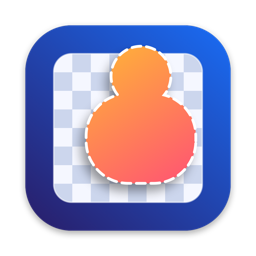
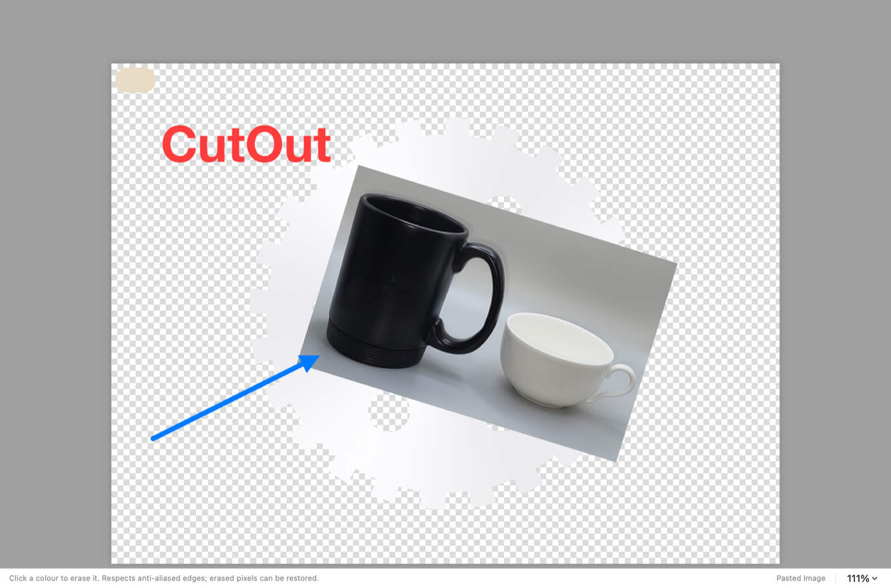

<p align="center"></p>

# CutOut

**Remove backgrounds, edit, layer and copy — fast, native and completely offline.**

CutOut is a native image editor for **macOS** and **Windows** built around one workflow:

1. Open CutOut, press **⌘V** (or drop / open an image).
2. Click **Remove Background**.
3. Optionally refine edges, erase, restore, paste more images as layers, add text or shapes.
4. **Copy** (⌘C), **Copy & Clear** (⇧⌘C) or **Copy & Close** (⌥⌘C) — the
   clipboard gets a real transparent PNG (plus TIFF with alpha for Keynote/PowerPoint).

Simple by default, powerful when needed: the tools sidebar (⌥⌘T) and layers
inspector (⌥⌘L) stay hidden until you want them.

> **Status:** v0.1 development build. **macOS:** Apple Silicon, macOS 14+,
> ad-hoc signed, **not notarized**. **Windows:** Windows 10 (1903) / 11, x64 and
> ARM64 — covered by automated tests and verified on a real Windows 11 x64 PC
> (ARM64 is built but untested on hardware). The installer is **not
> code-signed**, so SmartScreen may warn (see [docs/WINDOWS.md](docs/WINDOWS.md)).
> Licensed under the [MIT License](LICENSE).



## Highlights

* **Best-quality background removal on your Mac** — BiRefNet (MIT) on Core ML
  (GPU, ≈2.5 s on an M1), upscaled to full resolution with an edge-aware
  colour guided filter. The full build includes the model — no setup, works
  offline. ONNX Runtime on the CPU is the automatic fallback. **Fast mode**
  uses Apple Vision (built in).
* **Non-destructive**: removal and erasing write a layer mask, so every pixel
  can be restored with the Restore brush or *Restore All*.
* **Refine Edges**: edge-aware radius, smooth, feather, contrast, shift edge
  and colour **decontamination** (removes background fringes).
* **Colour tools that understand colour**: Magic Wand / Magic Eraser / colour
  deletion measure CIEDE2000 ΔE, so a beige backdrop is removed while a white
  part stays; contiguous or global; anti-aliased edges respected.
* **Real layers**: paste as layer, thumbnails, visibility, opacity, reorder,
  rename, duplicate, delete, move/scale/rotate with handles, merge down,
  merge selected, flatten, editable text layers, shapes.
* Selections: rectangle, ellipse, lasso, polygon, magic wand, quick selection;
  add / subtract / intersect; feather, grow, shrink, smooth, invert.
* Brush, eraser, restore (size, hardness, opacity/strength), paint bucket,
  eyedropper, crop, trim, resize, canvas size, rotate, flip, adjustments
  (exposure, contrast, highlights/shadows, saturation, temperature, tint, hue,
  sharpen, invert, greyscale, auto levels), before/after compare.
* **`.cutout` projects** keep layers, masks, transforms and text editable.
* Undo/redo everything; quitting or Copy & Clear never loses work silently
  (File ▸ Restore Last Session).
* Private by design: no telemetry, no accounts, no network except the model
  download you start; the clipboard is only read when you paste.

## Download / build

```bash
scripts/build.sh --dmg
```

Outputs `dist/CutOut.app` and `dist/CutOut.dmg` (standard, 12 MB). For the
full build with the Core ML model inside (DMG 403 MB) use
`BUNDLE_COREML=1 scripts/build.sh --dmg`. See
[docs/BUILDING.md](docs/BUILDING.md) for requirements, first-launch steps for
unsigned builds, manual model installation and tests.

## Documentation

| | |
|---|---|
| [Architecture](docs/ARCHITECTURE.md) | Rust engine + SwiftUI/AppKit shell, rendering, data model, security |
| [AI models](docs/MODELS.md) | Candidate evaluation, benchmark results, licences, quality findings |
| [Windows edition](docs/WINDOWS.md) | Architecture, install, build, troubleshooting, limitations |
| [Third-party notices](LICENSES/THIRD_PARTY_NOTICES.md) | Dependency and model licences |

## Keyboard shortcuts

| Action | Keys | Action | Keys |
|---|---|---|---|
| Paste (new layer) | ⌘V | Remove background | ⌘B (Fast: ⇧⌘B) |
| Copy / & Clear / & Close | ⌘C / ⇧⌘C / ⌥⌘C | Compare before/after | \\ |
| Undo / Redo | ⌘Z / ⇧⌘Z | Fit / Actual size | ⌘0 / ⌘1 |
| Save project | ⌘S | Export PNG | ⇧⌘E |
| Tools sidebar / Layers | ⌥⌘T / ⌥⌘L | Brush size | [ / ] |
| Move V · Marquee M · Ellipse O · Lasso L · Polygon P · Wand W · Quick Q | | Magic Eraser E · Eraser X · Restore R · Brush B · Bucket G · Eyedropper I · Text T · Shapes U · Crop C · Hand H (or Space) · Zoom Z | |

## Known limitations

The most important limitations:

* The Neural Engine is not used yet (GPU instead); the ONNX CPU fallback is
  slow (≈14 s, ≈9 GB peak). The in-app model download is disabled until a
  hosting location is approved — use the full build or Install from File.
* Segmentation models cannot produce partial transparency for glass or
  translucent materials; use the refinement tools for those.
* Apple Silicon only; not notarized; 8-bit sRGB pipeline.
