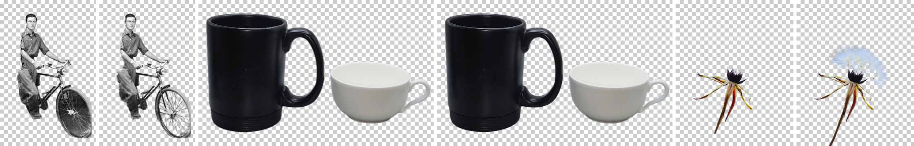

# Background-removal model analysis

## Candidates considered

| Candidate | Type | Licence | Verdict |
|---|---|---|---|
| **BiRefNet (general)** — ZhengPeng7, 2024 | High-resolution dichotomous segmentation (Swin-L backbone, 1024² input), soft output | **MIT** | **Selected default.** Best detail on hair/fur, thin structures, holes, white-on-light. ONNX export available from onnx-community at a pinned revision. |
| BiRefNet Lite | Same family, Swin-T backbone | MIT | Offered as an option; measurably weaker on holes/low contrast and **not faster on CPU** in our runs. |
| BiRefNet fp16 export | Same weights, half precision | MIT | Offered as "compact": identical matte (alpha MAE 0.0000 vs fp32 on the cat image), half the download, ≈15 % slower on CPU. |
| **BiRefNet (general) → Core ML** — same weights, converted locally | fp16 ML Program, deformable convs decomposed (`tools/convert`) | MIT | **Default for Best Quality** (CPU+GPU): ≈2–2.5 s instead of ≈14 s, ≈2 GB instead of ≈9 GB peak; parity with the ONNX matte (below). Shipped precompiled inside the full CutOut.app, or installed in-app from a verified file; never published to an external service so far. |
| BiRefNet-matting / BiRefNet_HR-matting | Matting variants (safetensors only) | MIT | Not used yet: no ONNX/Core ML export; conversion requires PyTorch. Recommended next step for translucent materials. |
| BRIA RMBG-1.4 / RMBG-2.0 | IS-Net / BiRefNet derived | **CC BY-NC 4.0** | Rejected: non-commercial licence conflicts with future open-source distribution. |
| IS-Net (DIS) | Segmentation, 1024² | Apache-2.0 | Older than BiRefNet and lower DIS-benchmark scores from the same research line; not pursued. |
| U²-Net / rembg models | Segmentation, 320² | Apache-2.0 | Too low resolution for fine detail. |
| **Apple Vision** `VNGenerateForegroundInstanceMaskRequest` | System subject lifting (macOS 14+) | Part of macOS | **Fast mode**: built in, ~1 s, no download. Good on people/animals; tends to keep or drop secondary objects. |
| ViTMatte / MODNet etc. | Trimap / portrait matting | various | Matting needs a trimap or is portrait-specific; candidate for a future refinement pass. |

All weights were downloaded from the publisher's Hugging Face repositories at
fixed revisions and verified by SHA-256:

| File | Bytes | SHA-256 |
|---|---|---|
| `onnx-community/BiRefNet-ONNX@534d3c82` `onnx/model.onnx` | 972 666 916 | `58f621f00f5d756097615970a88a791584600dcf7c45b18a0a6267535a1ebd3c` |
| same, `onnx/model_fp16.onnx` | 489 666 272 | `3654c741eb80bd926ada8fed1713b506ccf8d30eb1f6487e87eb9f234f33df09` |
| `onnx-community/BiRefNet_lite-ONNX@de15b22b` `onnx/model.onnx` | 224 005 088 | `5600024376f572a557870a5eb0afb1e5961636bef4e1e22132025467d0f03333` |
| `ZhengPeng7/BiRefNet@66f7f80c` `model.safetensors` (Core ML conversion source) | 884 878 856 | `77277264c0e8c74149d3ff2fade4fd8176965b7108f3c5fc3b8c9c811edb4519` |
| Core ML output `weight.bin` (produced locally by `tools/convert`) | 463 618 272 | `66044c149f7a152d9b1c522a681a09ebb9d73db5fd27fefaf05c79ec9034287f` |

ONNX files are computation graphs loaded by ONNX Runtime — no pickle, no
custom Python code.

## Benchmark set

Reproducible with `bench/fetch_images.sh`, `cutout-cli synth`, `bench/run_models.sh` and `bench/vision_bench.swift`.

* **Synthetic scenes with exact ground-truth alpha** (generated by
  `cutout-cli synth`, 3×3 supersampled): white machined gear with bolt holes
  on beige (white-on-light, holes); chrome bracket with slot on light grey
  (reflective metal, low contrast, hole); 1–3 px dark strands on light grey
  (hair/wire); 45 % translucent tinted disc over a checker texture (glass).
* **Real photos** (Wikimedia Commons, licences in `bench/images.tsv`): tabby
  cat (fur, whiskers), 36 MP curly-hair portrait (hair, large image), wine
  glass on white (glass), dandelion seed head (thin translucent detail), white
  cup and black mug on light background, vintage bicycle (spokes, holes).

Metrics against ground truth: alpha **MAE**, **IoU** of the binarised matte,
and **edge MAE** in a ±6 px band around the true boundary.

## Results

### Synthetic scenes with exact ground truth (lower MAE / higher IoU is better)

| Scene | BiRefNet + CutOut refinement | BiRefNet raw (bicubic upscale only) | Apple Vision (Fast) | BiRefNet Lite* |
|---|---|---|---|---|
| White gear with holes on beige | **IoU 0.9994**, MAE 0.0012, edge 0.019 | IoU 0.9972, MAE 0.0012, edge 0.020 | IoU 0.9919, MAE 0.0063 | IoU 0.9995, MAE 0.0012 |
| Fine 1–3 px strands | **IoU 0.992**, MAE 0.012, edge 0.061 | IoU 0.956, MAE 0.014, edge 0.072 | IoU 0.929, MAE 0.019 | IoU 0.985, MAE 0.013 |
| Chrome bracket with slot | IoU 0.834, MAE 0.063 (slot kept) | IoU 0.834, MAE 0.063 | IoU 0.834, MAE 0.065 | IoU 0.515, MAE 0.182 |
| 45 % translucent disc | IoU 0.105, MAE 0.156 (fails) | same | IoU 0.104 (fails) | same |

\* Lite numbers come from a run with background load; timings for Lite are not comparable.

### Timing (M1, CPU EP, 8 threads, refinement on)

| Image | Size | Inference | Post-processing | Total |
|---|---|---|---|---|
| bicycle | 783 × 1200 | 14.7 s | 0.2 s | 15.0 s |
| cat_fur | 2810 × 2810 | 14.1 s | 0.3 s | 14.5 s |
| chrome_bracket | 1600 × 1000 | 13.7 s | 0.1 s | 13.8 s |
| curly_hair | 4912 × 7360 (36 MP) | 15.5 s | 1.4 s | 17.0 s |
| dandelion | 1440 × 1800 | 13.5 s | 0.2 s | 13.7 s |
| fine_strands | 1400 × 1400 | 14.7 s | 0.2 s | 14.9 s |
| mug_vs_cup | 1993 × 1244 | 14.9 s | 0.2 s | 15.2 s |
| white_gear_on_beige | 1600 × 1200 | 14.2 s | 0.1 s | 14.4 s |
| wine_glass | 1536 × 2048 | 13.6 s | 0.2 s | 13.8 s |

Model load 2.7 s, first-run warm-up 13 s, peak RSS of the benchmark process
9.4 GB. Apple Vision: 0.2–1.1 s for ≤ 8 MP, 5.2 s for the 36 MP portrait.

### Visual comparison (real photos)

Left to right, in pairs: **Vision | BiRefNet**. Bicycle: Vision fills the
wheels, BiRefNet removes the background between the spokes. Mug & cup: both
good. Dandelion: Vision drops the seed fluff, BiRefNet keeps it. (Images:
public domain and CC0, see `bench/images.tsv`.)

## Execution provider findings (important)

* **ONNX Runtime CoreML EP, ML Program format**: model compilation fails after
  ~10 minutes (`Required param 'pad' is missing` in a deformable-convolution
  block).
* **CoreML EP, NeuralNetwork format, all compute units**: the Apple Neural
  Engine compiler ran for >20 minutes without finishing.
* **CoreML EP, NeuralNetwork format, CPU+GPU**: loads in 10.5 s, then the
  process is killed by the OS during inference (memory).
* **CPU EP (default)**: reliable. Threads: 8 (all cores) 14.0 s, 4 (P-cores)
  16.5 s, 2 threads 24.8 s on the same image — so CutOut uses all cores.
  Disabling the memory arena and lowering graph optimisation did **not**
  reduce peak memory (≈8–9 GB RSS during a 1024² inference); the activations
  of this architecture are simply large.

Conclusion: ONNX Runtime runs BiRefNet only on the CPU provider. The fast
path is therefore a direct PyTorch → Core ML conversion, described next.

## Core ML conversion (tools/convert)

`tools/convert/install.sh` converts the pinned PyTorch release
(`ZhengPeng7/BiRefNet@66f7f80c`, the same 2024-07-28 weights as the ONNX
export) with coremltools 9.0 / torch 2.7.0 in a hash-locked venv; see
[tools/convert/README.md](../tools/convert/README.md). Changes to the graph:

* the 20 modulated **deformable convolutions** are rewritten exactly as one
  `grid_sample` (bilinear, zeros, `align_corners=True`) per kernel tap ×
  modulator, summed through 1×1 convolutions — max |Δp| 8·10⁻⁵ against
  torchvision's `deform_conv2d` in fp32;
* Swin `window_partition` / `window_reverse` and `image2patches` use rank-6
  reshapes; replaced with rank-5 equivalents (Core ML's tensor-rank limit);
* fp16 ML Program, static 1×3×1024² input, sigmoid output.

The app (`CoreMLSegmenter`) feeds the network the exact tensor the ONNX path
builds and post-processes with the same Rust code (`cutout_ai_preprocess` /
`cutout_ai_postprocess`, including `refine_alpha`), so only the network
differs.

**Compute units.** CPU+GPU compiles in ≈5 s (once; cached) and runs in ≈2 s.
With *all* units (Neural Engine) the ANE compiler again did not finish
(`ANECompilerService` still busy after 25 min, same as with the ORT CoreML EP; the process is system-owned and keeps running in the background until it gives up), so the app requests `.cpuAndGPU`
(`CUTOUT_COREML_UNITS=all|ane|cpu` overrides for experiments).

**Parity** (`bench/run_coreml.sh build/convert/BiRefNet.mlpackage gpu`,
refinement on, vs. ONNX fp32 CPU on the same inputs; targets ΔIoU ≤ 0.002,
Δedge MAE ≤ 0.005):

| Scene (ground truth) | ONNX CPU IoU / edge MAE | Core ML IoU / edge MAE | ΔIoU | Δedge MAE |
|---|---|---|---|---|
| White gear with holes | 0.9994 / 0.0186 | 0.9995 / 0.0185 | +0.0001 | −0.0001 |
| Fine 1–3 px strands | 0.9920 / 0.0612 | 0.9915 / 0.0593 | −0.0005 | −0.0019 |
| Chrome bracket with slot | 0.8344 / 0.1842 | 0.8344 / 0.1847 | 0.0000 | +0.0005 |
| 45 % translucent disc | 0.1047 / 0.4814 | 0.1046 / 0.4814 | −0.0001 | 0.0000 |

Agreement of the full-resolution mattes with the ONNX mattes (alpha MAE /
binarised IoU): synthetic scenes ≤ 0.0009 / ≥ 0.998; real photos cat 0.0004 /
0.9993, curly hair 0.0006 / 0.9993, wine glass 0.0006 / 0.9988, mug & cup
0.0003 / 0.9996, dandelion 0.0018 / 0.982 (fluff tips), bicycle 0.0012 / 0.995 (spoke gaps).
JPEG photos are decoded by ImageIO in the bench and by the `image` crate in
`cutout-cli`, so part of the real-photo difference is decoder rounding, not
the model.

**Independent re-run and visual review (2026-11-04).** A clean rebuild
re-ran both backends back to back on all 10 images with identical results:
the synthetic metrics in the table above reproduced to four decimals and
real-photo agreement was the same. The regions with the largest per-pixel
disagreement were inspected side by side: the bicycle's tyre against its
ground shadow (max 178/255 over a few dozen pixels), the faint dandelion
fluff, and a dark shadow sliver beside the curly-hair portrait's jeans.
In each case both answers are plausible readings of an ambiguous edge and
neither backend is consistently better. Absolute quality of the Core ML
cutouts was reviewed on every photo: whiskers, curly hair, the wine glass
(opaque), spokes, dandelion fluff, the white cup and the gear's holes are
clean; the chrome slot is kept, exactly as with ONNX.

## Shipping the Core ML model to users (no Python, no conversion)

End users never run the converter. Core ML models cannot be built on a Mac
without Python/coremltools, so the converted model must be distributed
pre-converted. Implemented options:

| Option | How | Size | Offline | Status |
|---|---|---|---|---|
| **A. Bundled in the app (recommended)** | `BUNDLE_COREML=1 scripts/build.sh --dmg` precompiles the verified package with `coremlcompiler` (deployment target macOS 14) into `CutOut.app/Contents/Resources/Models/…mlmodelc` | app 477 MB, **DMG 403 MB** (vs 31 / 12 MB) | Yes, from first launch, zero setup | Built and self-tested (fresh user with empty model folder: Core ML used, 7.5 s first removal incl. load, 2.6 s after) |
| B. Install from file | Model setup ▸ **Install from File…** accepts the `.zip` from `MODEL_ARCHIVE=1 scripts/build.sh` (401 MB) or a `.mlpackage`; the weight SHA-256 must match before anything is replaced; installed atomically into Application Support | 401 MB file | Yes | Built and self-tested (corrupt archive rejected; verified archive installed and used) |
| C. One-time in-app download | Same verified install path, fed by `CoreMLBiRefNet.download` (URL + size + SHA-256) | 401 MB download | After download | **Disabled**: needs an approved hosting location (e.g. a GitHub Release asset or a Hugging Face repo under ca-works). Nothing has been uploaded. |
| D. Developer recipe | `tools/convert/install.sh` (Python, PyTorch, coremltools, ≈5 min) | — | — | Kept for developers and for re-creating the pinned output |

Licensing: BiRefNet is MIT; redistributing the converted weights (A–C) is
permitted with the copyright and licence notice, which ships in
`THIRD_PARTY_NOTICES.md` inside the app. The converted weights are
reproducible from `tools/convert` (pinned sources, pinned output hash).

Reliability: bundled models are covered by the app's code signature; the
installed package is hash-verified once (cached per size + mtime) and
compiled once into `~/Library/Caches/CutOut/coreml/compiled` (old compiled
versions are pruned). If Core ML fails to load or run, CutOut releases the
Core ML model and falls back to the ONNX CPU model when it is installed
(self-tested with a forced failure); if no ONNX model is installed, the error
says so. Intel Macs skip Core ML (validated on Apple Silicon only) and use
ONNX — not built or tested on Intel yet.

## Quality findings

* **Excellent**: hair and fur (cat whiskers survive), curly hair at 36 MP,
  bicycle spokes with background removed between them, dandelion fluff, white
  cup on a light background, the white gear on beige (IoU 0.999), 1–3 px
  strands (IoU 0.99).
* **Weak**: enclosed holes whose interior resembles a plausible surface (the
  chrome bracket's slot is kept). Fix in seconds with **Magic Eraser**
  (contiguous click inside the hole).
* **Not solvable by segmentation**: true partial transparency (glass, smoke,
  the translucent disc). The wine glass is cut out cleanly as an opaque object;
  real see-through alpha would need a matting model.
* Upscaling + guided-filter refinement keeps solid regions exactly 0/255 and
  only adapts the uncertain edge band to full-resolution image edges.
* Decontaminate (Refine Edges) removes background colour bleeding from
  semi-transparent edge pixels (unit-tested on a red/green blend).
